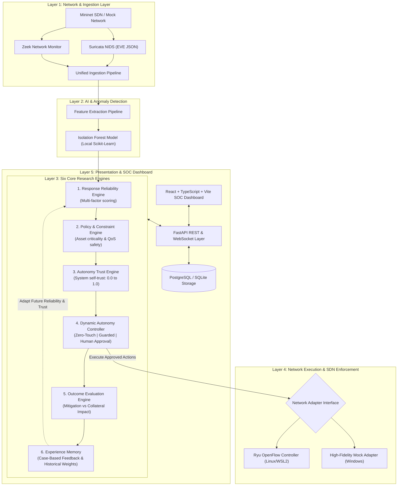
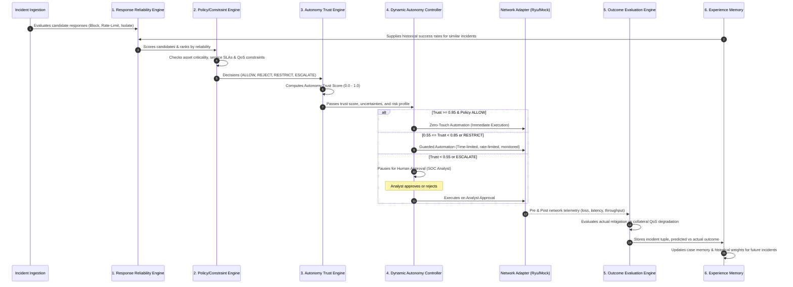
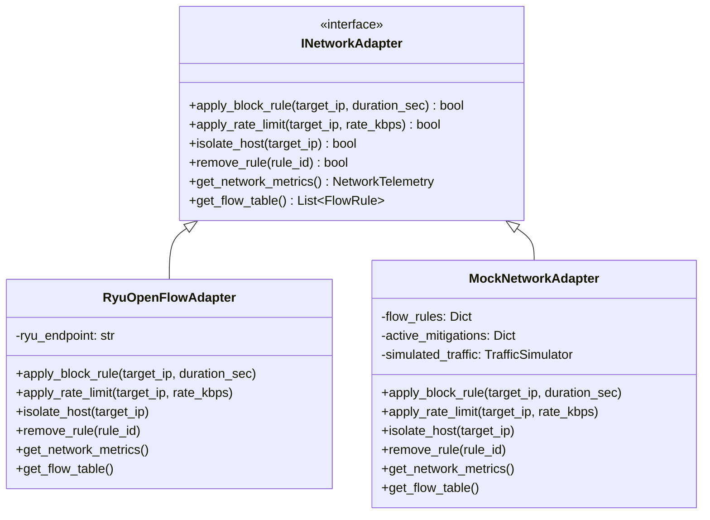

# Trust-Aware SOAR Architecture Specification

## 1. System Overview & Multi-Layer Architecture

The Trust-Aware Security Orchestration, Automation, and Response (SOAR) framework extends traditional automation by evaluating not only whether a threat exists, but also whether candidate responses are reliable, policy-compliant, and safe to execute autonomously.

---

## 2. Six Core Research Engines & Decision Pipeline

The central research contribution lies in the interaction among the 6 modular engines:

---

## 3. Mathematical Foundations

### Component 1: Response Reliability Score
$$\text{Reliability}(r) = w_1 \cdot C_{\text{threat}} + w_2 \cdot S_{\text{hist}}(r) + w_3 \cdot P_{\text{fit}}(r) - w_4 \cdot Q_{\text{risk}}(r) - w_5 \cdot R_{\text{risk}}(r) - w_6 \cdot U$$
Normalized to $[0, 1]$, where:
- $C_{\text{threat}}$: Threat detection confidence $[0, 1]$
- $S_{\text{hist}}$: Historical response success from Experience Memory $[0, 1]$
- $P_{\text{fit}}$: Policy compatibility score $[0, 1]$
- $Q_{\text{risk}}$: Predicted Quality-of-Service disruption risk $[0, 1]$
- $R_{\text{risk}}$: Infrastructure resource consumption risk $[0, 1]$
- $U$: Epistemic & statistical uncertainty $[0, 1]$
- Weights: $\sum_{i=1}^6 w_i = 1.0$ (configurable in settings)

### Component 3: Autonomy Trust Score
$$\text{Trust}(r) = \alpha \cdot \text{Reliability}(r) + \beta \cdot C_{\text{threat}} + \gamma \cdot (1 - Q_{\text{risk}}) - \delta \cdot U - \lambda \cdot F_{\text{hist}}$$
Where $F_{\text{hist}}$ is the historical failure/override penalty.

### Component 4: Autonomy Mode Selection
$$\text{Mode} = \begin{cases}
\text{ZERO\_TOUCH} & \text{if } \text{Trust} \ge \tau_{\text{high}} \text{ and Policy} = \text{ALLOW} \\
\text{GUARDED} & \text{if } \tau_{\text{low}} \le \text{Trust} < \tau_{\text{high}} \text{ or Policy} = \text{RESTRICT} \\
\text{HUMAN\_APPROVAL} & \text{if } \text{Trust} < \tau_{\text{low}} \text{ or Policy} \in \{\text{ESCALATE}, \text{REJECT}\}
\end{cases}$$
Default thresholds: $\tau_{\text{high}} = 0.85$, $\tau_{\text{low}} = 0.55$. Mandatory safety policies always strictly override trust scores.

---

## 4. Dual-Mode Network Execution Architecture

